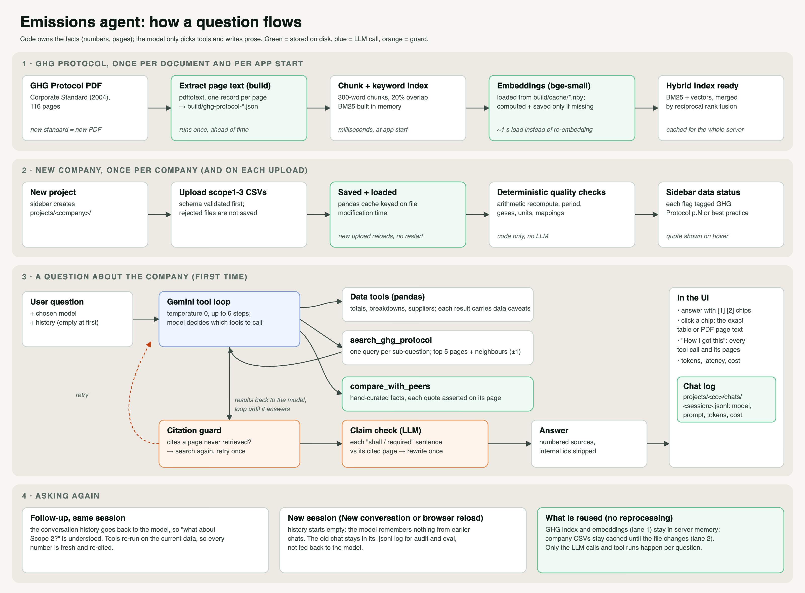

# Write-up: Emissions Analysis & Insights Agent

## Solution
A single Gemini agent (`gemini-4-hydrogen`, temperature 0) runs a manual tool loop with three kinds of tools:
- **pandas tools** for the CSVs: they compute the numbers, so the model never does arithmetic;
- **GHG Protocol retrieval**;
- **a peer-comparison tool**.

Every number is cited as a data source and every rule as a PDF page. The UI turns these into clickable chips that show the underlying table or page text. The design principle is that **the model writes prose, and code owns the facts.**

## Architecture

- **Data.** Each company has its own folder in `projects/<company>/`. Uploads are schema-validated and hot-reloaded, using a cache keyed on file modification time. Each data tool result carries that project's open data-quality findings (`data_caveats`), so answers state the caveats inline.
- **Knowledge.**
  - The Protocol PDF is extracted with plain `pdftotext`, which was chosen over `-layout` in E01.
  - It is split into 300-word chunks and searched with hybrid BM25 + bge-small, merged with reciprocal rank fusion. The top 5 hits are returned with their neighbouring pages. Page text is extracted once ahead of time and the chunk embeddings are cached on disk, so the index loads in about a second and is built once per app start, not per question.
  - Compound questions are split into one query each.
- **Peers.** Facts are hand-curated from both peer PDFs. A build script asserts that each fact's quote appears on its cited page. Shopify's figures come from a chart, so RAG over that PDF would not be reliable.
- **Guards.**
  1. A citation guard retries once if the answer cites a page that was never retrieved.
  2. A claim check verifies every "shall/required/must" sentence against the cited page, with one rewrite if unsupported.
  3. Internal ids are stripped from answers.
- **Model choice in the UI.** The user can pick the model, or compare up to four Gemini models side by side on the same question, with latency, tokens, cost and whether a guard fired.
- **Data-status flags** in the sidebar are each tagged as a GHG Protocol requirement (with the PDF page and quote, shown on hover) or as best practice. The page references were checked by hand.
- **Summary report** ("Generate summary report" button, `report.py`). Code collects the totals, the hotspots in each scope and the data-quality findings. One LLM call proposes reduction actions, each pointing to a hotspot id with an effort rating and a first step; code then attaches the tonnes and shares, so no figure in the advice comes from the model. The output is a single self-contained HTML page: headline, scope cards, hotspot charts, a priority matrix (effort vs size, flagged where the data must be fixed first), action cards, the data-quality list and the peer comparison, saved to `projects/<company>/reports/`.

## Data observations
- Each scope file has 3 flagged findings, and all arithmetic recomputes.
- Steam is about 84% of Scope 2. The Protocol defines Scope 2 around purchased electricity (p.27), while the p.35 footnote extends it. This tension is surfaced rather than hidden.
- Supplier and category fields have gaps, so supplier prioritisation carries explicit data caveats.

## Evaluation
- **Retrieval:** see the RAG experiments section below.
- **Agent (E10–E13):**
  - The six brief questions were rerun for every prompt and model version and saved side by side in `results/`.
  - Moving to `gemini-4-hydrogen` fixed the two failures that prompt changes alone did not: Core 1's calculation method and Core 2's verdict consistency.
- **Scored agent eval (E16, `eval_agent.py`):**
  - Each brief question has deterministic checks: required facts, required tool calls, cited pages, and no leaked ids or uncited pages. Ground truth comes from the data tools and hand-checked pages, never from an LLM.
  - With 3 fresh runs per question, 114 of 114 checks passed with no variance between runs. The only first-pass failure was a bug in the grader, not in the agent.
  - This proves facts and grounding are present. It does not grade prose quality.
- **Ledger.** Every experiment, with its caveats, is in `EXPERIMENTS.md`.

## Model comparison (E13, E17)
The same agent, prompt and rubric (`eval_agent.py --model ...`) were run on each Gemini model available to the key. The app's compare view shows the same thing for any single question.

| Model | Checks passed | Mean latency | Input tokens / answer | List-price cost / answer |
|---|---|---|---|---|
| gemini-4-hydrogen (default) | 114/114 (3 runs) | 10.4 s | 12.6k | $0.005 |
| gemini-3.8-flash | 76/76 (2 runs) | 13.7 s | 22.5k | $0.009 |
| gemini-2.5-flash | 75/76 (2 runs) | 5.5 s | 13.2k | $0.006 |
| gemini-4-carbon | 51/52 (partial: stopped during Bonus 2, API stalled) | not saved | | |

- All models get the numbers right, because the numbers come from tools, not the model. Differences show up in reasoning-heavy questions: the only misses were on Core 1 (business travel), where a model sometimes dropped one side of the Scope 1 / Scope 3 answer.
- The rubric checks facts, not answer quality, so it understates the gap. Reading the answers side by side (E13, `results/COMPARISON.md`), `gemini-4-hydrogen` was clearly better than `gemini-2.5-flash`, which is why it became the default:
  - **Core 1:** hydrogen gives both sides (Scope 3, or Scope 1 if company-owned) plus cited calculation steps and the Protocol's mobile-combustion tool; flash gave a vaguer method.
  - **Core 2:** hydrogen opens with one consistent verdict; flash's verdict contradicted its own points.
  - **Bonus 1 and 2:** hydrogen puts the data caveats next to each claim and ends with a recommendation (fix the supplier mapping, collect primary data).
  - Prompt changes alone had not fixed these; changing the model did.
- `gemini-4-hydrogen` was kept as the default: no misses, no variance, and the lowest tokens per answer. `gemini-2.5-flash` is about twice as fast and would suit a latency-sensitive deployment.
- Caveat: 2 runs per model for the challengers; one miss in 76 checks is within noise.

## RAG experiments (E01–E08)
The retrieval setup was chosen by measurement, not by default. Full details and caveats are in `EXPERIMENTS.md`.
- **Extraction (E01).** `pdftotext -layout` interleaved the PDF's two columns; plain mode kept key sentences intact on the pages checked, so plain text is used.
- **Eval set (E04).** 49 questions, each with a gold page verified by an exact quote, plus 6 negatives whose answers are not in the PDF.
- **Grid search without an LLM (E02–E04).** 135 configurations: chunk size (page, 150, 300, 600 words) × retriever (BM25, dense, hybrid) × top-k (1, 3, 5) × what is returned (chunk, page, page±1, page±2). Hybrid had the best hit rate (0.90 vs 0.85 BM25, 0.82 dense). The top configurations were within noise of each other, so 300-word chunks, hybrid, k=5 were kept.
- **Error analysis (E05).** Two failure types: answers scattered across glossary and appendix pages, and negatives that sound answerable scoring as high as real questions (the out-of-scope limit below).
- **Answer quality with an LLM (E06).** Returning page±1 instead of the page alone raised key-point coverage from 0.88 to 0.93 and correct abstentions from 5/6 to 6/6, at 1.8× the input tokens. Page±1 is the default; the sidebar can switch it.
- **Embedding models (E07–E08).** Six models compared: bge-small, bge-base, gte-base, MiniLM, e5-base and Gemini's API embedding. With hybrid retrieval all landed within 0.85–0.89 recall, so the small local bge-small was kept: free, private, and indexed in seconds.
- **Caveat.** 43 scorable questions means differences under about 5 points are noise, and the E06 judge is the same model that answered.

## Scaling
- **More companies:** swap the folder-per-project store for Postgres or DuckDB plus object storage, and keep the same tool interface.
- **More documents:** move to a vector database with page metadata, and keep the same eval set as a regression test.
- **Operations:** chats are already logged as JSONL with model, prompt version, tokens and cost, which is the raw material for monitoring and for growing the eval set.
- **Concurrency:** the active project is a module global, so the app is single-user. Production needs per-request project context.

## Limits and future improvements
- **Evaluation.** The rubric checks facts, not writing quality. Next: a human-graded rubric for usefulness and clarity, a hand-check of the E06 LLM judge (which grades its own model's answers), and a larger question set grown from logged chats. Run the same rubric across models from the compare view, so model choice is decided by score.
- **Knowledge.** Only the 2004 Corporate Standard is loaded. Adding the 2015 Scope 2 Guidance (market- vs location-based reporting) and the Scope 3 Standard would settle the steam and dual-reporting questions properly.
- **Out-of-scope questions.** Retrieval scores look equally confident whether or not the answer exists in the knowledge base (e.g. "the 15 Scope 3 categories" come from the later Scope 3 Standard, not the 2004 one). The citation guard and claim check stop unsupported claims, but a relevance check before answering would let the agent say plainly "this isn't in the loaded sources".
- **Peers.** Peer facts are hand-curated. An extraction pipeline with the same quote assertions would scale to many peers, and revenue data would allow intensity comparisons.
- **Production.** Per-request project context instead of a module global, a real database, authentication, and monitoring dashboards built from the JSONL chat logs.
- **Advice.** Reduction actions and effort ratings are model judgement. A domain expert review, and estimated reduction potential per action, would make the report decision-ready.
